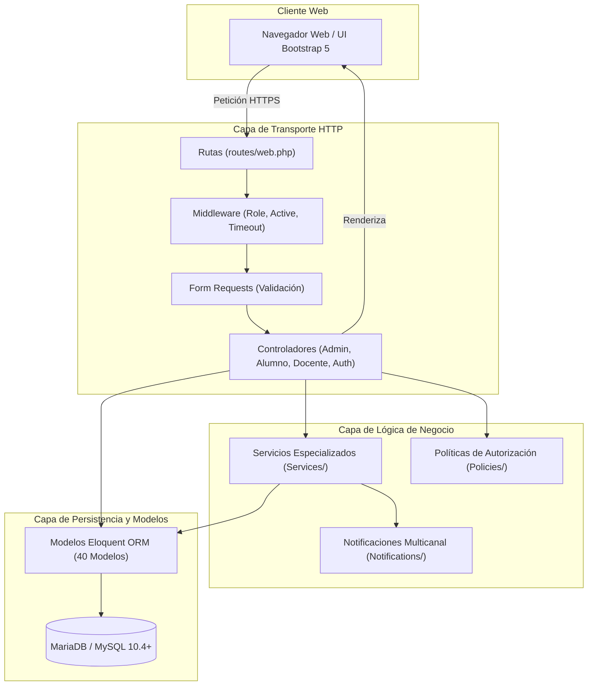

# Arquitectura del Sistema y Patrones de Diseño
## Plataforma Bienestar UPEMOR

Este documento describe la arquitectura técnica, la distribución en capas y las convenciones de diseño implementadas en la plataforma **Bienestar UPEMOR**, desarrollada bajo el framework **Laravel 12 (PHP 8.2+)**.

---

## 1. Visión General de la Arquitectura

La plataforma sigue una arquitectura en capas basada en el patrón **Modelo–Vista–Controlador (MVC)**, enriquecida con una **Capa de Servicios (Service Layer)**, **Form Requests** para validación declarativa, **Políticas de Autorización (Policies)** y **Notificaciones Multicanal**.

---

## 2. Capa de Controladores (`app/Http/Controllers`)

Los controladores son responsables exclusivamente de recibir las solicitudes HTTP, coordinar los servicios y devolver vistas Blade o respuestas estructuradas (JSON / descargas de archivos):

### 2.1 Subespacios de Controladores
- **`App\Http\Controllers\Auth\`**: Control de inicio de sesión, registro de alumnos, recuperación de contraseñas y cierre de sesión.
- **`App\Http\Controllers\Admin\`**: Gobernanza institucional:
  - `SolicitudAlumnoController`: Aprobación/rechazo de aspirantes.
  - `TrayectoriaAcademicaAdminController`: Ficha de trayectoria, estatus regular/irregular y cambio excepcional de plan.
  - `ReporteController`: Generación de 6 reportes analíticos con exportación PDF/Excel.
  - `RespaldoAdminController`: Respaldos MariaDB con SHA-256.
  - `CarreraController`, `PlanEstudioController`, `PeriodoAcademicoController`, `GrupoAdminController`, `DocenteAsignacionAdminController`: Estructura académica.
  - `UsuarioAdminController`, `RecompensaAdminController`, `TestAdminController`, `MeditacionAdminController`, `EncuestaAdminController`: Catálogos institucionales.
- **`App\Http\Controllers\Alumno\`**: Módulos del estudiante: `BitacoraController`, `EvaluacionController`, `CitaController`, `MeditacionController`, `RecompensaController` y `AcademicoController`.
- **`App\Http\Controllers\Docente\`**: Módulos de cátedras y orientación: `AcademicoController`, `CitaDocenteController`.

---

## 3. Capa de Servicios (`app/Services`)

La lógica de negocio compleja, los algoritmos de cálculo psicométrico y la generación de documentos se desacoplan de los controladores en servicios dedicados:

| Servicio | Responsabilidad Principal |
|---|---|
| **`TrayectoriaAcademicaService`** | Evalúa la condición regular/irregular de los alumnos, calcula el avance curricular, gestiona el cambio controlado de planes de estudio y valida la elegibilidad de asignaturas cuatrimestrales. |
| **`ReporteGraficaService`** | Extrae y consolida las métricas institucionales de los 6 reportes y genera exactamente **dos visualizaciones gráficas analíticas** por reporte listas para pantalla y exportaciones. |
| **`EvaluacionScoringService`** | Procesa las respuestas de cuestionarios clínicos (DASS-21), aplica baremos estandarizados, determina niveles de severidad y genera recomendaciones contextuales. |
| **`ExcelExportService`** | Construye libros de cálculo OpenXML (ISO/IEC 29500) puros sin dependencias binarias externas pesadas, asegurando compatibilidad con Microsoft Excel y LibreOffice Calc. |
| **`RespaldoService`** | Orquesta la ejecución de `mysqldump`, almacena volcados en rutas protegidas, calcula el hash SHA-256 y verifica la integridad antes de permitir descargas o restauraciones. |

---

## 4. Capa de Modelos y Persistencia (`app/Models`)

El sistema cuenta con **40 modelos Eloquent**, todos fuertemente tipados y documentados bajo el estándar PHPDoc:

- **Estructura de Llaves:** PKs personalizadas (`usuario_id`, `rol_id`, `programa_id`, `plan_id`, etc.) con relaciones declaradas mediante tipos de retorno nativos de PHP 8.2 (`BelongsTo`, `HasMany`, `BelongsToMany`).
- **Casting y Atributos:** Uso de `$casts` nativo para fechas, arrays JSON y tipos booleanos.
- **Consultas Seguras:** 100% de consultas construidas con Eloquent ORM y Query Builder con vinculación de parámetros PDO, garantizando protección absoluta contra inyección SQL.

---

## 5. Middleware y Seguridad Transversal

El pipeline HTTP implementa filtros de seguridad en `app/Http/Middleware`:

- **`EnsureUserHasRole` (`role:<nombre>`):** Verifica que el usuario autenticado cuente con el rol requerido para la ruta solicitada. Devuelve HTTP 403 en caso contrario.
- **`EnsureUserIsActive` (`account.active`):** Comprueba que la columna `users.estado` sea estrictamente `ACTIVO`. Si la cuenta está en `PENDIENTE`, `BLOQUEADO` o `INACTIVO`, destruye la sesión y redirige a la vista correspondiente.
- **`CheckSessionTimeout` (`session.timeout`):** Cierra la sesión automáticamente tras 15 minutos continuos de inactividad del usuario, protegiendo terminales compartidas en el campus.

---

## 6. Políticas de Autorización (`app/Policies`)

Se aplican directivas de autorización granular mediante `Gate` y `Policy`:
- Aislamiento estricto de expedientes clínicos y psicológicos: un docente regular no puede consultar notas clínicas de orientación ni respuestas detalladas de evaluaciones psicológicas.
- Protección de citas y bitácoras: los estudiantes únicamente pueden visualizar y modificar sus propios registros.

---

## 7. Notificaciones Multicanal (`app/Notifications`)

Existen **22 clases de notificación** en `app/Notifications` que soportan entrega simultánea por base de datos (notificación interna en campana) y correo electrónico (cuando se configura SMTP o servicio de mensajería).

