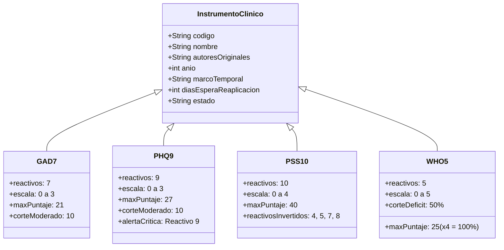
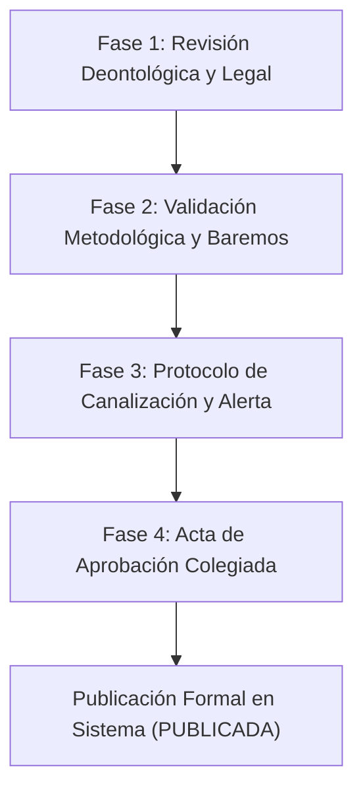

# Fuentes Académicas y Marco Metodológico de Evaluaciones Psicológicas
## Sistema de Bienestar Integral UPEMOR

**Documento Técnico-Académico de Referencia**  
*Módulo de Evaluaciones y Tamizaje Psicoemocional*  
*Universidad Politécnica del Estado de Morelos (UPEMOR)*  
*Fecha de elaboración: Noviembre de 2026*  
*Estado de implementación: Fase de Verificación y Validación Colegiada*

---

## 1. Introducción y Marco Deontológico

El módulo de Evaluaciones de **Bienestar UPEMOR** tiene como propósito ofrecer herramientas estandarizadas de tamizaje y autoconocimiento orientador para la comunidad universitaria. En estricto apego al **Código Ético del Psicólogo** (Sociedad Mexicana de Psicología) y a los estándares internacionales de la *American Psychological Association* (APA), se establece con claridad meridiana que:

1. **Naturaleza de Tamizaje (Screening):** Ningún cuestionario automatizado autoadministrado tiene la facultad per se de emitir un diagnóstico clínico definitivo o clasificatorio. Las puntuaciones obtenidas señalan exclusivamente la presencia, frecuencia o intensidad percibida de ciertos grupos de síntomas o estados afectivos en un marco temporal específico.
2. **No Sustitución del Criterio Profesional:** Los resultados constituyen un recurso orientador y preventivo. El diagnóstico clínico formal requiere obligatoriamente de una entrevista clínica individualizada, anamnesis y evaluación multidisciplinaria conducida por profesionales debidamente acreditados en salud mental.
3. **Privacidad y Custodia:** Las respuestas y puntajes brutos pertenecen a la esfera privada del estudiante y se resguardan bajo estrictas políticas de confidencialidad y control de acceso por roles.
4. **Política de Publicación:** De acuerdo con la arquitectura del sistema, los cuatro instrumentos oficiales permanecen en estado `BORRADOR` en la base de datos hasta que sean formalmente ratificados por el comité colegiado correspondiente de la UPEMOR.

---

## 2. Inventario de Instrumentos Oficiales

A continuación se presentan las fichas metodológicas exhaustivas con fuentes científicas verificables de los cuatro instrumentos seleccionados para el catálogo institucional.

---

### Instrumento 1: GAD-7 (Generalized Anxiety Disorder 7-item scale)

#### A. Ficha Técnica General
- **Nombre oficial:** Escala del Trastorno de Ansiedad Generalizada de 7 Reactivos (GAD-7).
- **Código en sistema:** `GAD-7`.
- **Categoría:** Ansiedad.
- **Marco temporal evaluado:** Últimas 2 semanas.
- **Número de reactivos:** 7 reactivos con redacción unidireccional.
- **Opciones de respuesta:** Escala Likert de 4 puntos:
  - 0 = *Para nada*
  - 1 = *Varios días*
  - 2 = *Más de la mitad de los días*
  - 3 = *Casi todos los días*
- **Rango de puntuación:** 0 a 21 puntos.
- **Tiempo estimado de respuesta:** 3 a 5 minutos.
- **Periodicidad mínima de reaplicación:** 14 días.

#### B. Cita Científica de los Autores Originales
> Spitzer, R. L., Kroenke, K., Williams, J. B., & Löwe, B. (2006). A brief measure for assessing generalized anxiety disorder: the GAD-7. *Archives of Internal Medicine*, 166(10), 1092–1097.  
> **DOI:** [10.1001/archinte.166.10.1092](https://doi.org/10.1001/archinte.166.10.1092)

#### C. Validación al Idioma Español
> García-Campayo, J., Zamorano, E., Ruiz, M. A., Pardo, A., Pérez-Páramo, M., López-Gómez, V., Freire, O., & Rejas, J. (2010). Cultural adaptation to Spanish of the Generalized Anxiety Disorder-7 (GAD-7) scale as a screening tool. *Health and Quality of Life Outcomes*, 8(1), 8.  
> **DOI:** [10.1186/1477-7525-8-8](https://doi.org/10.1186/1477-7525-8-8)

#### D. Validación en Población Mexicana y Estudiantes Universitarios
> Román-Mendoza, A. D., Morales-Chainé, S., & López-Rosales, F. (2021). Propiedades psicométricas de la Escala del Trastorno de Ansiedad Generalizada (GAD-7) en estudiantes universitarios mexicanos. *Revista Digital Internacional de Psicología y Ciencia Social*, 7(2), 245–262.  
> 
> Benjet, C., Bromet, E., Karam, E. G., Kessler, R. C., McLaughlin, K. A., Ruscio, A. M., ... & World Health Organization World Mental Health Survey Collaborators. (2016). The epidemiology of generalized anxiety disorder in the World Health Organization World Mental Health Surveys. *Psychological Medicine*, 46(8), 1779–1791.

#### E. Puntos de Corte e Interpretación Psicométrica
| Rango de Puntuación | Nivel de Severidad de Síntomas | Significado Metodológico |
| :---: | :---: | :--- |
| **0 – 4** | Mínimo | Sintomatología de ansiedad no significativa o basal. |
| **5 – 9** | Leve | Presencia de síntomas aislados de tensión o inquietud. Se recomiendan pautas de autocuidado e higiene del sueño. |
| **10 – 14** | Moderado | **Punto de corte estándar ($\ge 10$):** Sensibilidad del 89% y especificidad del 82% para detección de probable trastorno de ansiedad generalizada. Se sugiere orientación psicológica. |
| **15 – 21** | Severo | Sintomatología ansiosa marcada con probable interferencia funcional importante. Requiere sugerencia de valoración presencial. |

#### F. Limitaciones Metodológicas
El GAD-7 fue concebido como instrumento de tamizaje en atención primaria. No discrimina con exactitud entre ansiedad generalizada, fobia social o trastorno de pánico, debido a la superposición sintomática. Un puntaje alto nunca debe interpretarse como diagnóstico clínico formal.

---

### Instrumento 2: PHQ-9 (Patient Health Questionnaire 9-item scale)

#### A. Ficha Técnica General
- **Nombre oficial:** Cuestionario de Salud del Paciente - Módulo de Depresión (PHQ-9).
- **Código en sistema:** `PHQ-9`.
- **Categoría:** Estado de ánimo.
- **Marco temporal evaluado:** Últimas 2 semanas.
- **Número de reactivos:** 9 reactivos basados directamente en los 9 criterios del DSM-IV / DSM-5 para el Episodio Depresivo Mayor.
- **Opciones de respuesta:** Escala Likert de 4 puntos (0 = *Para nada*, 1 = *Varios días*, 2 = *Más de la mitad de los días*, 3 = *Casi todos los días*).
- **Rango de puntuación:** 0 a 27 puntos.
- **Tiempo estimado de respuesta:** 4 a 6 minutos.
- **Periodicidad mínima de reaplicación:** 14 días.

#### B. Cita Científica de los Autores Originales
> Kroenke, K., Spitzer, R. L., & Williams, J. B. (2001). The PHQ-9: validity of a brief depression severity measure. *Journal of General Internal Medicine*, 16(9), 606–613.  
> **DOI:** [10.1046/j.1525-1497.2001.016009606.x](https://doi.org/10.1046/j.1525-1497.2001.016009606.x)

#### C. Validación al Idioma Español
> Diez-Quevedo, C., Rangil, T., Sánchez-Planell, L., Kroenke, K., & Spitzer, R. L. (2001). Validation and utility of the Spanish version of the PHQ-9 in medical patients. *General Hospital Psychiatry*, 23(4), 226–232.  
> **DOI:** [10.1016/S0163-8343(01)00155-7](https://doi.org/10.1016/S0163-8343(01)00155-7)

#### D. Validación en Población Mexicana y Estudiantes Universitarios
> Aguerrebere, M., et al. (2018). Validación y propiedades psicométricas del Cuestionario de Salud del Paciente (PHQ-9) en comunidades de México. *Salud Pública de México*, 60(5), 542–551.  
> 
> Morales-Chainé, S., López-Rosales, F., Bosch, A., & Berenzon, S. (2020). Propiedades psicométricas del Cuestionario sobre la Salud del Paciente (PHQ-9) en población general y universitaria mexicana. *Revista Mexicana de Psicología*, 37(2), 115–127.

#### E. Puntos de Corte e Interpretación Psicométrica
| Rango de Puntuación | Severidad de Síntomas Depresivos | Recomendación Orientadora |
| :---: | :---: | :--- |
| **0 – 4** | Mínima o ausente | Rango de normalidad funcional; fomento de hábitos saludables. |
| **5 – 9** | Leve | Síntomas afectivos moderados pero no incapacitantes; psicoeducación y seguimiento voluntario. |
| **10 – 14** | Moderada | **Umbral clínico orientador ($\ge 10$):** Sensibilidad 88% y especificidad 88%. Se sugiere canalización preventiva para entrevista diagnóstica. |
| **15 – 19** | Moderadamente severa | Disminución notable en la funcionalidad y energía diaria; recomendación enfática de valoración psicológica/médica. |
| **20 – 27** | Severa | Alta afectación emocional cotidiana. Requiere atención prioritaria por especialistas. |

#### F. Protocolo Ético Crítico: Reactivo 9 (Ideación y Autolesión)
El reactivo 9 del PHQ-9 indaga: *«Pensamientos de que sería mejor estar muerto o de hacerte daño de alguna manera»*.  
En todo sistema digital, la respuesta a este reactivo tiene implicaciones deontológicas impostergables:
- Cualquier puntuación mayor a cero ($1, 2, 3$) debe activar inmediatamente una pantalla de apoyo con información de contacto de urgencias (ej. **Línea de la Vida en México: 800 911 2000**, Servicios de Salud de Morelos y Área de Orientación y Tutorías de UPEMOR).
- El sistema no debe procesar esto como una acusación ni como una etiqueta punitiva, sino con empatía y un mensaje de acompañamiento respetuoso y confidencial.

---

### Instrumento 3: PSS-10 (Perceived Stress Scale 10-item)

#### A. Ficha Técnica General
- **Nombre oficial:** Escala de Estrés Percibido de 10 Reactivos (PSS-10).
- **Código en sistema:** `PSS-10`.
- **Categoría:** Estrés.
- **Marco temporal evaluado:** Último mes.
- **Número de reactivos:** 10 reactivos (6 directos y 4 inversos).
- **Opciones de respuesta:** Escala Likert de 5 puntos:
  - 0 = *Nunca*
  - 1 = *Casi nunca*
  - 2 = *De vez en cuando*
  - 3 = *A menudo*
  - 4 = *Muy a menudo*
- **Rango de puntuación:** 0 a 40 puntos.
- **Tiempo estimado de respuesta:** 5 a 7 minutos.
- **Periodicidad mínima de reaplicación:** 21 días (debido a su marco temporal mensual).

#### B. Cita Científica de los Autores Originales
> Cohen, S., Kamarck, T., & Mermelstein, R. (1983). A global measure of perceived stress. *Journal of Health and Social Behavior*, 24(4), 385–396.  
> **DOI:** [10.2307/2136404](https://doi.org/10.2307/2136404)

#### C. Validación Psicométrica en Población Mexicana
> González-Ramírez, M. T., & Landero-Hernández, R. (2007). Factor structure of the Perceived Stress Scale (PSS) in a sample from Mexico. *The Spanish Journal of Psychology*, 10(1), 199–206.  
> **DOI:** [10.1017/s1138741600006466](https://doi.org/10.1017/s1138741600006466)  
> 
> González-Ramírez, M. T., Rodríguez-Ayán, M. N., & Landero-Hernández, R. (2013). The 10-item version of the Perceived Stress Scale: Psychometric properties in a Mexican sample. *Trastornos Adictivos*, 15(1), 19–24.

#### D. Particularidad de Calificación: Reactivos Invertidos
La PSS-10 evalúa dos dimensiones: *Percepción de Estrés/Sobrecarga* y *Autoeficacia/Afrontamiento percibido*. Los reactivos **4, 5, 7 y 8** están redactados en sentido positivo, por lo que su puntaje debe invertirse estrictamente en el cálculo del servidor antes de sumarse al puntaje total:

$$\text{Puntaje Invertido} = 4 - \text{Valor Opción}$$

| Opción seleccionada por el alumno | Valor nominal | Valor real computado en servidor |
| :--- | :---: | :---: |
| Nunca | 0 | **4** |
| Casi nunca | 1 | **3** |
| De vez en cuando | 2 | **2** |
| A menudo | 3 | **1** |
| Muy a menudo | 4 | **0** |

#### E. Puntos de Corte e Interpretación
El estrés percibido es un constructo psicológico relativo y no una entidad diagnóstica nosológica:
| Puntuación Total | Nivel de Estrés Percibido | Interpretación Psicosocial |
| :---: | :---: | :--- |
| **0 – 13** | Bajo | Adecuada sensación de control sobre las demandas del entorno cotidiano. |
| **14 – 26** | Moderado | Percepción normal de exigencia o sobrecarga; común durante periodos de entregas o exámenes universitarios. |
| **27 – 40** | Alto | Percepción elevada de que las exigencias superan las capacidades personales de afrontamiento. Se recomiendan técnicas de modulación del estrés, organización del tiempo y apoyo tutorial. |

---

### Instrumento 4: WHO-5 (World Health Organization-Five Well-Being Index)

#### A. Ficha Técnica General
- **Nombre oficial:** Índice de Bienestar General de la Organización Mundial de la Salud (WHO-5).
- **Código en sistema:** `WHO-5`.
- **Categoría:** Bienestar general.
- **Marco temporal evaluado:** Últimas 2 semanas.
- **Número de reactivos:** 5 reactivos breves redactados positivamente (afecto positivo, vitalidad y descanso).
- **Opciones de respuesta:** Escala Likert de 6 puntos:
  - 0 = *En ningún momento*
  - 1 = *Menos de la mitad del tiempo*
  - 2 = *Más o menos la mitad del tiempo*
  - 3 = *Más de la mitad del tiempo*
  - 4 = *Casi todo el tiempo*
  - 5 = *Todo el tiempo*
- **Rango de puntuación:** Puntuación bruta de 0 a 25 puntos. Puntuación estandarizada: 0 a 100% ($\text{Bruta} \times 4$).
- **Tiempo estimado de respuesta:** 2 a 3 minutos.
- **Periodicidad mínima de reaplicación:** 14 días.

#### B. Cita Científica del Autor y Promotor Institucional
> Bech, P. (1998). *The WHO-5 Well-Being Index*. Psychiatric Research Unit, WHO Collaborating Centre for Mental Health, Mental Health Centre North Zealand, Hillerød, Denmark.  
> 
> Topp, C. W., Østergaard, S. D., Søndergaard, S., & Bech, P. (2015). The WHO-5 Well-Being Index: a systematic review of the literature. *Psychotherapy and Psychosomatics*, 84(3), 167–176.  
> **DOI:** [10.1159/000376585](https://doi.org/10.1159/000376585)

#### C. Validación al Idioma Español
> Campo-Arias, A., Miranda-Tapia, G. A., & Cogollo, Z. (2015). Propiedades psicométricas del Índice de Bienestar General de 5 ítems de la OMS (WHO-5) en estudiantes de medicina y población hispanohablante. *Revista Colombiana de Psiquiatría*, 44(3), 160–165.  
> **DOI:** [10.1016/j.rcp.2015.02.004](https://doi.org/10.1016/j.rcp.2015.02.004)

#### D. Puntos de Corte e Interpretación Psicométrica
| Puntuación Bruta (0-25) | Índice Porcentual (0-100) | Interpretación del Estado de Bienestar |
| :---: | :---: | :--- |
| **0 – 12** | **0 – 48%** | **Bienestar deficiente o subóptimo:** Una puntuación $\le 50$ en el índice porcentual o $<13$ en la escala bruta indica riesgo de desánimo significativo y sugiere una exploración complementaria del estado de ánimo (sensibilidad $>90\%$ para detección de ánimo deprimido). |
| **13 – 19** | **52 – 76%** | **Bienestar moderado:** Funcionamiento cotidiano aceptable con fluctuaciones anímicas estándar. |
| **20 – 25** | **80 – 100%** | **Bienestar óptimo y alta vitalidad:** Percepción positiva de energía, sosiego y plenitud cotidiana. |

---

## 3. Resumen Comparativo de Instrumentos

| Parámetro | GAD-7 | PHQ-9 | PSS-10 | WHO-5 |
| :--- | :---: | :---: | :---: | :---: |
| **Objetivo central** | Tamizaje de síntomas ansiosos | Tamizaje de síntomas del ánimo | Medición de sobrecarga percibida | Medición positiva de bienestar |
| **Nº de Reactivos** | 7 | 9 | 10 | 5 |
| **Marco Temporal** | Últimas 2 semanas | Últimas 2 semanas | Último mes | Últimas 2 semanas |
| **Puntaje Mín/Máx** | 0 – 21 | 0 – 27 | 0 – 40 | 0 – 25 (0–100%) |
| **Reactivos Invertidos** | Ninguno | Ninguno | 4 reactivos (4, 5, 7, 8) | Ninguno |
| **Punto de Alerta Orientadora** | $\ge 10$ puntos | $\ge 10$ puntos (o R9 $> 0$) | $\ge 27$ puntos | $\le 50\%$ ($\le 12$ pts) |
| **Reaplicación mínima** | 14 días | 14 días | 21 días | 14 días |

---

## 4. Requisitos y Procedimiento para Aprobación Colegiada en UPEMOR

Para que las versiones de estos cuatro instrumentos pasen del estado `BORRADOR` al estado `PUBLICADA` en la base de datos de producción (`bienestar_upemor`), debe cumplirse formalmente el siguiente proceso estructurado en cuatro etapas:

### Fase 1: Revisión Deontológica y Protección de Datos Personales
- **Alineación Normativa:** Comprobación del cumplimiento de la Ley General de Protección de Datos Personales en Posesión de Sujetos Obligados (LGPDPPSO) aplicable al estado de Morelos y al reglamento interno de la UPEMOR.
- **Consentimiento Informado Institucional:** Redacción final y ratificación de la cláusula de consentimiento voluntario, asegurando que el estudiante comprenda plenamente que sus datos se manejan con secreto profesional y con fines exclusivos de apoyo académico y bienestar.

### Fase 2: Validación Metodológica y Calibración de Baremos
- **Revisión por Especialistas:** Dictamen emitido por el equipo de profesionales en psicología adscritos al Área de Desarrollo y Bienestar Estudiantil de UPEMOR, avalando que las traducciones seleccionadas corresponden al lenguaje y contexto cultural de la juventud universitaria de Morelos.
- **Aprobación de la Tabla de Baremos:** Aprobación explícita de los rangos interpretativos y recomendaciones de autocuidado que se mostrarán al estudiante al concluir cada prueba.

### Fase 3: Protocolo de Canalización Asistida y Manejo de Crisis
- **Directorio de Canalización Vigente:** Vinculación técnica de los números telefónicos, correos y cubículos de atención psicológica presencial de la UPEMOR, así como del convenio con las unidades de salud mental pública del estado (SSM).
- **Ruta Crítica del Reactivo 9:** Protocolo formal y operativo para el seguimiento no estigmatizante de aquellos estudiantes que expresen ideas pasivas o activas de autolesión en el PHQ-9.

### Fase 4: Dictamen y Acta de Aprobación Colegiada
- **Sesión de Consejo Técnico / Comité de Bienestar:** Presentación formal del expediente metodológico ante el comité colegiado correspondiente de la universidad.
- **Emisión del Acta Administrativa:** Firma de autorización colegiada por parte de la Secretaría Académica y la Coordinación de Tutorías y Orientación Educativa.
- **Activación en Producción:** Ejecución del comando de migración o script administrativo que cambia el campo `estado = 'PUBLICADA'` en la tabla `evaluaciones_versiones`, habilitando la visualización y resolución por parte de la matrícula estudiantil.

---

## 5. Matriz de Estado y Niveles de Validación

| Componente Metodológico | GAD-7 | PHQ-9 | PSS-10 | WHO-5 |
| :--- | :---: | :---: | :---: | :---: |
| **1. Publicación original verificada** | Spitzer et al. (2006) | Kroenke et al. (2001) | Cohen et al. (1983) | Bech (1998), Topp (2015) |
| **2. Validación en español / México comprobada** | García-Campayo (2010), Román-Mendoza (2021) | Diez-Quevedo (2001), Morales-Chainé (2020) | González & Landero (2007, 2013) | Campo-Arias (2015) |
| **3. Periodicidad mínima de reaplicación** | 14 días | 14 días | 21 días (marco mensual) | 14 días |
| **4. Estado actual en base de datos** | `BORRADOR` (Inactivo para alumnos) | `BORRADOR` (Inactivo para alumnos) | `BORRADOR` (Inactivo para alumnos) | `BORRADOR` (Inactivo para alumnos) |
| **5. Estatus de reactivos clínicos** | No publicados en catálogo | No publicados en catálogo | No publicados en catálogo | No publicados en catálogo |
| **6. Criterios clínicos pendientes** | Puntos de corte para canalización | Protocolo de alerta reactivo 9 | Ponderación de reactivos invertidos | Algoritmo porcentual de vitalidad |
| **7. Aprobación colegiada requerida** | Pendiente sesión institucional | Pendiente sesión institucional | Pendiente sesión institucional | Pendiente sesión institucional |
| **8. Limitación principal de uso** | Tamizaje de ansiedad, no diagnóstico | Tamizaje del ánimo, requiere entrevista | Medida perceptual, estrés no es patología | Indicador de bienestar, no prueba de depresión |

